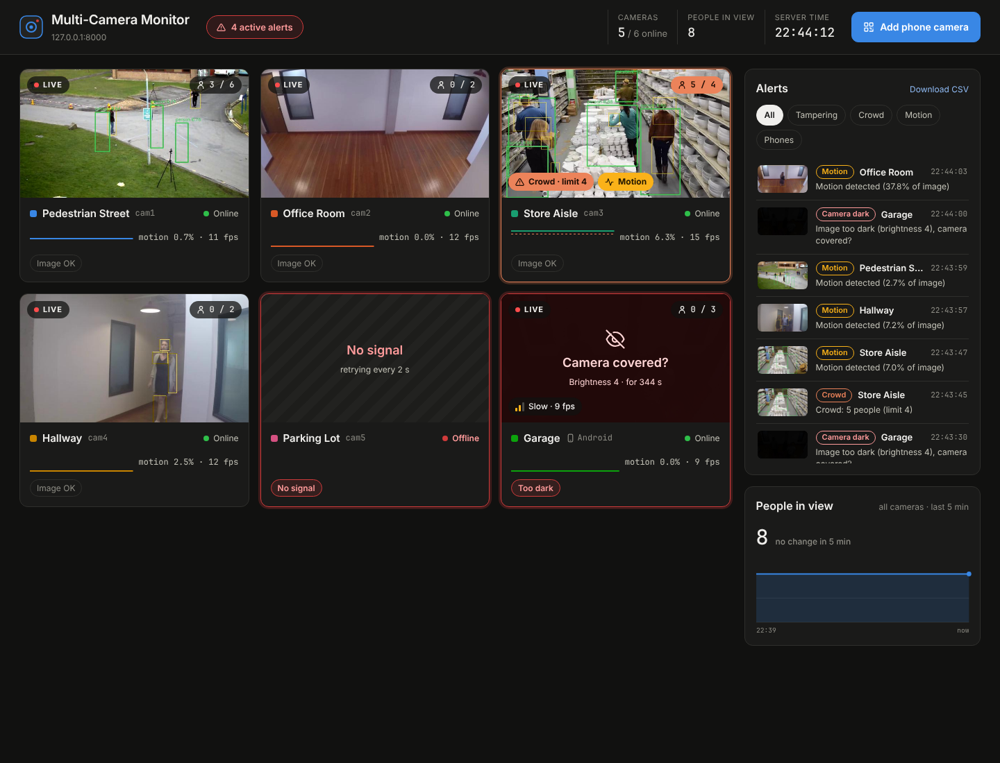

# Multi-Camera Monitoring Dashboard

Real-time monitoring of several camera feeds in one web dashboard, with video analytics:
camera status, FPS, motion detection, tampering detection (dark/blurry), people counting
(YOLOv8n), crowd alerts, history charts and an SQLite event log with snapshots. Any phone
can join as a live camera from its browser by scanning a QR code.



## The dashboard

- **Camera cards**: live video with person boxes; LIVE, people count and alert chips on top.
  The card itself shows the state: orange glow = crowd, red glow + "Camera covered?" /
  "Lens dirty?" = tampering, red "No signal" = video camera offline, dashed grey "Waiting for
  phone" = a phone that paused (normal, no alarm). Phone cards show connection quality.
  Each card has a 5-minute sparkline of people in view.
- **Header**: one status pill ("All clear" or "N active alerts"), cameras online, people, time.
- **Alerts**: newest first with a snapshot of the moment, filters (tampering, crowd, motion,
  phones), click to open that camera; **Download CSV** exports the whole log.
- **Spotlight**: click a camera to see it large, with people / motion / FPS / YOLO time,
  image-health bars with the tampering thresholds, its people chart with the crowd limit,
  its own alerts, a **Save snapshot** button and full screen. Esc goes back.
- **Add phone camera**: a QR code to scan with the phone (link with the phone token inside);
  the dialog shows "… connected" when the phone starts streaming.

Built with Python, OpenCV, ultralytics YOLO, Flask, Caddy, Docker; deployed on an Azure VM.
CSCI 436 Introduction to Cloud Computing final project.

## How it works

```
 video files ──┐                                   ┌── dashboard in a browser
               ├─> camera workers ─> web server ───┤      (password protected)
 phones ───────┘   (1 thread per    (Flask)        └── /phone page on a phone
  (upload JPEG       camera:                              (needs PHONE_TOKEN)
   frames)           analytics)          ▲
                                         │ HTTP inside Docker
                                       Caddy  <── HTTPS from the internet (ports 80, 443)
```

1. Every camera has a **worker thread** that reads frames, runs the analytics (motion, image
   quality, people) and keeps the latest annotated frame, stats and 5 minutes of history.
2. A camera's frames come from a **source**: a video file played in a loop, or a **phone**
   that uploads JPEG frames to the server.
3. The **web server** shows the dashboard and the JSON API, streams video to browsers (MJPEG),
   and receives phone uploads.
4. **Caddy** sits in front and provides HTTPS with a free, automatically renewed certificate.
   Phones only allow the camera on HTTPS pages, and the dashboard password must be encrypted.

## Project layout

```
app/
  main.py               entry point: starts the cameras and the web server
  config.py             reads config.yaml, sets up logging
  events.py             event log (SQLite) with a cooldown per alert type
  cameras/
    sources.py          where frames come from: video file, or phone uploads
    worker.py           one thread per camera: analytics, alerts, latest frame, stats
    manager.py          list of all cameras; adds and removes phone cameras
  analytics/
    motion.py           motion detection (background subtraction)
    quality.py          brightness and sharpness (tampering)
    people.py           people detection (YOLOv8n)
  web/
    dashboard.py        dashboard page, video streams, JSON API, /health
    phone.py            phone page and phone upload API
    auth.py             dashboard password
  templates/            dashboard.html, phone.html
  static/               dashboard.js, phone.js, style.css, phone.css (no frameworks; charts are SVG)
deploy/
  Caddyfile             HTTPS front door settings
  azure_setup.sh        one-command deployment on an Azure Ubuntu VM
  AZURE_VM_GUIDE.md     step-by-step VM instructions and troubleshooting
scripts/                test scripts for steps 1 and 2
videos/                 sample videos (credits in videos/SOURCES.md)
config.yaml             cameras + analytics thresholds
.env.example            template for secrets (copy to .env)
docker-compose.yml      the two containers: dashboard + caddy
logs/, results/         execution logs, snapshots, benchmarks, screenshots (submission)
```

## Run with Docker (recommended)

```bash
cp .env.example .env              # then edit: password, phone token, address
docker compose up -d --build      # build and start dashboard + caddy
docker compose logs -f            # live logs
docker compose down               # stop
```

Open `https://localhost` (or `http://localhost:8000` on the same machine). With
`SITE_ADDRESS=localhost` or an IP address, the browser warns once about the certificate.
To test with a phone on the same Wi-Fi, set `SITE_ADDRESS` to your computer's LAN IP
(e.g. `192.168.1.20`) and open `https://192.168.1.20/phone` on the phone.

## Deploy on Azure

Short version below; the full guide (everyday commands, settings, troubleshooting) is
[`deploy/AZURE_VM_GUIDE.md`](deploy/AZURE_VM_GUIDE.md).

1. In the Azure portal, VM → *Networking* → add inbound rules allowing TCP **80** and **443**
   (or with the Azure CLI: `az vm open-port -g <resource-group> -n <vm-name> --port 80 --priority 1010`
   and the same with `--port 443 --priority 1020`).
   Port 8000 does not need to be open any more.
2. On the VM:
   ```bash
   git clone https://github.com/NurstanDuisengaliyev/multi-camera-dashboard.git
   cd multi-camera-dashboard
   bash deploy/azure_setup.sh
   ```
   The first run creates `.env` with a random dashboard password and phone token, and uses
   `<ip-with-dashes>.sslip.io` as the address (a free name that points to the VM's IP), so
   Caddy can get a trusted certificate. Run `cat .env` on the VM to see the secrets.
3. Open `https://<ip-with-dashes>.sslip.io` and log in (user `admin`).

## Stream from a phone

1. On the dashboard, click **Add phone camera** and scan the QR code with the phone (or copy
   the link and send it). The link contains the phone token: it gives streaming rights only,
   not the dashboard password. Or open `https://<server>/phone` and type the token.
2. Enter a camera name (e.g. "Front door"), pick a quality (Data saver / Balanced / Sharp),
   tap the red button and allow the camera.
3. The phone appears on the dashboard within a second, with the same analytics as the other
   cameras. **Stop streaming** removes it; a phone that loses its connection shows
   "Waiting for phone" and is removed after `remove_after_s` (60 s).

The page draws each camera frame on a canvas, encodes it as JPEG and uploads it. It sends the
next frame only after the previous one arrived, so a slow network lowers the FPS instead of
adding delay. Keep the browser in the foreground with the phone unlocked: phones pause the
camera in the background. "Balanced" (640 px, 15 FPS) uses roughly 2–7 Mbit/s; "Data saver"
(480 px, 8 FPS) is better on mobile data.

## Run without Docker (development)

```bash
python3 -m venv .venv
.venv/bin/pip install -r requirements.txt
PHONE_TOKEN=test .venv/bin/python -m app.main     # http://localhost:8000
```

Without `DASHBOARD_PASSWORD` the dashboard is open (fine on your own computer). Phones need
HTTPS, so for phone testing use Docker (Caddy). On the same computer, `http://localhost:8000/phone`
works because browsers treat localhost as secure.

Test scripts:

```bash
.venv/bin/python -m scripts.run_workers 30     # step 1: video workers, FPS, offline detection
.venv/bin/python -m scripts.run_analytics 60   # step 2: analytics + every alert type + benchmark
```

## Configuration

- [`config.yaml`](config.yaml): video cameras (id, name, file, crowd limit), phone camera limits
  and all analytics thresholds. In Docker it is mounted into the container: after editing, run
  `docker compose restart dashboard`, no rebuild needed.
- `.env` (secrets and address, read by docker compose; template in [`.env.example`](.env.example)):

| Variable | Meaning |
|---|---|
| `SITE_ADDRESS` | address people open: a domain (trusted certificate) or `localhost` / an IP |
| `DASHBOARD_USER`, `DASHBOARD_PASSWORD` | dashboard login; no password = dashboard open to everyone |
| `PHONE_TOKEN` | secret phones need to stream; empty = phone streaming off |

Also supported: `PORT` (local port, default 8000), `CONFIG_PATH`, `LOG_DIR`, `DATABASE`.

## Endpoints

| Path | Login | Description |
|---|---|---|
| `/` | password | Dashboard |
| `/video/<cam_id>` | password | Live MJPEG stream |
| `/snapshot/<cam_id>.jpg` | password | Current picture (`?download=1` to save it as a file) |
| `/api/cameras` | password | Stats of all cameras + summary |
| `/api/history` | password | Last 5 min of people / motion per camera |
| `/api/events?limit=50` | password | Latest alerts |
| `/api/events/<id>/snapshot.jpg` | password | Picture saved when that alert fired |
| `/api/events.csv` | password | Whole event log as CSV |
| `/api/phone-link` | password | Phone link + QR code (SVG) for the "Add phone camera" dialog |
| `/health` | – | Health check |
| `/phone` | – | Phone streaming page |
| `POST /api/phone/start` | token | `{"name": ...}` → `{"camera_id": ...}`: create a phone camera |
| `POST /api/phone/<id>/frame` | token | upload one JPEG frame (header `X-Phone-RTT`: last round trip, ms) |
| `POST /api/phone/<id>/stop` | token | remove the phone camera |

"password" = dashboard user/password (HTTP Basic auth); "token" = header `X-Phone-Token: <PHONE_TOKEN>`.
